I'm the founder of **QuarkTex**, where your own AI works in front and a Hive of specialist agents works behind it.
I think in systems, start from first principles, and ship working software. The cards below are live: the numbers
are pulled from GitHub every morning.

## Building

  
  
  
  

## How I operate

- Humans teach the brain rather than orchestrate agents.
- Context is more valuable than isolated intelligence.
- Infrastructure compounds. Memory compounds.
- Reflection improves decisions.

## Stack

<samp>Python · TypeScript · React · Next.js · FastAPI · Gemini on Vertex AI · Claude · Cloud Run · Firestore · three.js · CadQuery · KiCad</samp>

<picture>
  <source media="(prefers-color-scheme: dark)" srcset="https://raw.githubusercontent.com/prasanna0070/prasanna0070/output/snake-dark.svg">
  
</picture>

  <samp>
    <a href="https://www.quarktex.com">quarktex.com</a> ·
    <a href="https://www.linkedin.com/in/prasanna-kasthurirangan">linkedin</a> ·
    <a href="mailto:prasanna@quarktex.com">prasanna@quarktex.com</a>
  </samp>

<!-- The header and cards are SVGs drawn by scripts/build_profile.py and refreshed daily by
     .github/workflows/profile.yml. The snake comes from Platane/snk on the output branch. -->
